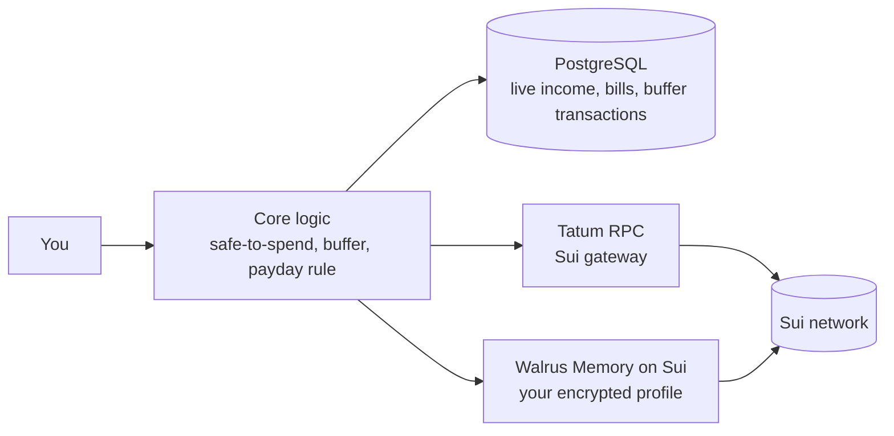

# Diction

**Spend your earnings wisely.**

Diction is a money tool for people whose income is unpredictable: freelancers, creators, traders and gig workers. It tells you one simple thing: **how much you can safely spend right now.**

Built for the **Walrus x Tatum Hackathon**.

> **Demo video:** [Watch the demo on X](https://x.com/Valourxbt/status/2120690168671973619)

---

## The problem, in plain words

Most budgeting apps assume you get the same paycheck on the same day every month.

Freelancers don't. You might earn $3,000 one month and $300 the next, while rent, bills and subscriptions still arrive on schedule. So people:

- **overspend** in good months,
- **borrow** in bad months,
- get hit by **tax bills** they never set money aside for,
- wait weeks for **clients who pay late**, and
- have **no steady paycheck** to plan around.

## Our idea

**Separate when money arrives from when bills are due, using a buffer in the middle.**

All your income lands in one holding pool first. From that pool, Diction pays your bills and pays *you* a steady salary. Whatever is left over is the money that is safe to spend.

---

## What Diction does

| Feature | What it means for you |
|---|---|
| **Holding buffer** | Every payment you receive goes into one pool first, never straight into spending. The pool grows toward a target you choose, such as 6 months of essential bills. |
| **Bill calendar** | Every bill and its due date in one place. Diction looks 30 to 60 days ahead so nothing catches you off guard. |
| **Safe-to-spend number** | One number that answers "what can I spend without worrying?" It already accounts for bills, tax and your own salary. |
| **Self-paid salary** | The buffer pays you a fixed amount on a fixed date, like a normal paycheck. It never pays so much that the buffer drops below a safety floor you set. |
| **Learned client habits** | Diction learns how late each client really pays and adjusts its forecasts to match. |
| **A profile you own** | Your patterns, rules and preferences are saved on Walrus Memory (on Sui), encrypted and controlled by you. |

### A worked example

Here is how the safe-to-spend number is calculated, using sample numbers:

| | Amount |
|---|---:|
| Money in your buffer | $6,200 |
| Minus bills due in the next 60 days | −$1,450 |
| Minus tax you should set aside | −$900 |
| Minus the salary you owe yourself this cycle | −$1,500 |
| Plus expected income ($2,000 × 80% client reliability) | +$1,600 |
| **Safe to spend** | **$3,950** |

The same logic as a formula:

```
safe_to_spend =
    buffer balance
  - bills due in the next 30-60 days
  - tax set-aside owed
  - salary owed this cycle
  + expected income (weighted by how reliable each client is)
```

**Salary example.** With a $1,500 salary and a $1,000 buffer floor:

- Buffer at $6,200: Diction pays the full **$1,500**.
- Buffer at $1,800: Diction pays **$800**, so the buffer never drops below $1,000.

**Late-payment example.** If three clients pay 5, 9 and 10 days late, Diction learns the average delay is **8 days** and pushes its income forecasts back by that much.

---

## How we use Walrus and Tatum

Diction uses both sponsors' technology for the job each one is best at.

### Walrus Memory: the profile you own

Slow-changing, personal data (client payment patterns, payday rules, preferences) is stored on **Walrus Memory** on Sui. It is encrypted and belongs to the user, not to us. If you leave Diction, your financial profile stays yours.

### Tatum RPC: the connection to Sui

All reads from the Sui network go through the **Tatum Sui gRPC gateway**. The connection code lives in one small file, `src/storage/tatumRpc.ts`, and `scripts/checkTatum.ts` lets you confirm the connection works in one command.

### Hackathon criteria at a glance

| Criterion | How Diction addresses it |
|---|---|
| **Walrus and Tatum integration** | Walrus Memory holds the user-owned profile (see the proof below). Tatum's Sui gRPC gateway is the network connection. |
| **Technical quality** | Money logic is pure, tested TypeScript, kept separate from storage code. Storage and network code is isolated in `src/storage/`, so any layer can be swapped without touching the money rules. |
| **Creativity** | A buffer that turns lumpy income into a paycheck, plus a profile the user truly owns. |
| **Presentation** | This README, the docs in `docs/`, and the demo video above. |

---

## Proof of Walrus mainnet usage

Diction has saved **12 memories to Walrus mainnet**. Each blob ID below is one of those writes. Click an ID to open it on [Walruscan](https://walruscan.com), the Walrus explorer.

| # | Blob ID (Walrus mainnet) |
|--:|---|
| 1 | [`u8Rsp27o1CxFM8yxsHOcEESwH0secjNMe0NvD0AGX4o`](https://walruscan.com/mainnet/blob/u8Rsp27o1CxFM8yxsHOcEESwH0secjNMe0NvD0AGX4o) |
| 2 | [`ZkiJaZfU92AUTrpPzzq0Vxq5BFcN23LSNt9WFVlsx2w`](https://walruscan.com/mainnet/blob/ZkiJaZfU92AUTrpPzzq0Vxq5BFcN23LSNt9WFVlsx2w) |
| 3 | [`yx1832b9-26NMvNsykQ874WY-5_DyzgQmpvWlTFU6so`](https://walruscan.com/mainnet/blob/yx1832b9-26NMvNsykQ874WY-5_DyzgQmpvWlTFU6so) |
| 4 | [`VeRKiHwLbb4F51RiNV1nD1uL4seM0PvEOj8vuXeZoHg`](https://walruscan.com/mainnet/blob/VeRKiHwLbb4F51RiNV1nD1uL4seM0PvEOj8vuXeZoHg) |
| 5 | [`xTPEGIKRexfkQ64ZblDU1KObkE-nj6Mg731F4xBAxgQ`](https://walruscan.com/mainnet/blob/xTPEGIKRexfkQ64ZblDU1KObkE-nj6Mg731F4xBAxgQ) |
| 6 | [`Q1Dsn0qZd_vpO4t9KxXlKWju2I3nY50b2VYrlqikn6g`](https://walruscan.com/mainnet/blob/Q1Dsn0qZd_vpO4t9KxXlKWju2I3nY50b2VYrlqikn6g) |
| 7 | [`rPX2Qo3PyNO7Kn544NmPzehSdyk2EXByIB1aLb0BJwY`](https://walruscan.com/mainnet/blob/rPX2Qo3PyNO7Kn544NmPzehSdyk2EXByIB1aLb0BJwY) |
| 8 | [`SbNFL59ipO8LsBw_0SfZFgeo3wZ6kGTfWa8l_9XJvHw`](https://walruscan.com/mainnet/blob/SbNFL59ipO8LsBw_0SfZFgeo3wZ6kGTfWa8l_9XJvHw) |
| 9 | [`S7wCo_eoHLOT0oLaKvkNBFjFRLjUshGTBksYzBqXqoA`](https://walruscan.com/mainnet/blob/S7wCo_eoHLOT0oLaKvkNBFjFRLjUshGTBksYzBqXqoA) |
| 10 | [`F3XyZ6xzkgjxu8jYHXqexhunZRNQl8yfmm5JUW5MUqM`](https://walruscan.com/mainnet/blob/F3XyZ6xzkgjxu8jYHXqexhunZRNQl8yfmm5JUW5MUqM) |
| 11 | [`oXwpBtDAsnLvSpUHpiv72wH8Z-rHVm3FzFYpwQaiWpc`](https://walruscan.com/mainnet/blob/oXwpBtDAsnLvSpUHpiv72wH8Z-rHVm3FzFYpwQaiWpc) |
| 12 | [`HgLK8xYx9JvyZJlTU-6nXaru-byUGoYY4yiqzvjCmLM`](https://walruscan.com/mainnet/blob/HgLK8xYx9JvyZJlTU-6nXaru-byUGoYY4yiqzvjCmLM) |

**Why the raw data looks unreadable.** Diction memories are encrypted before they are stored. If you fetch a blob directly from a Walrus server, you will see scrambled characters instead of text. That is expected, and it is the point: only the owner of the profile can read it. Walruscan confirms the blob exists on mainnet.

You can also check any blob from the command line with `walrus blob-status --blob-id <BLOB_ID>`.

---

## Architecture



| Layer | Purpose | Technology |
|---|---|---|
| Core logic | Safe-to-spend, buffer balance, payday rule, client-delay learning | TypeScript |
| Database | Live calculations: income events, bill payments, buffer transactions | PostgreSQL |
| Walrus Memory | User-owned, encrypted profile (patterns, rules, preferences) | Walrus Memory on Sui |
| Tatum RPC | Reads from Sui through a managed gateway | Tatum Sui gRPC |

The core logic has **no storage code in it**. Everything that touches the database, Walrus or Sui lives in `src/storage/`.

---

## Project status

- [x] Problem defined and data model designed
- [x] Database schema and sample data
- [x] Safe-to-spend, buffer and payday logic, with unit tests
- [x] Client-delay learning
- [x] Tatum RPC connection (Sui gRPC gateway)
- [x] Memories saved to Walrus mainnet (see the proof above)
- [x] Walrus Memory adapter wired into the app (`src/storage/walrusMemory.ts`)
- [x] Database adapter wired into the app (`src/storage/database.ts`)
- [x] Web interface
- [x] Money layer (how the buffer holds real funds)

---

## Getting started

**You need:** Node.js 18 or newer, and a free API key from the [Tatum dashboard](https://dashboard.tatum.io).

```bash
git clone https://github.com/Catalyst30/Tatum-hackathon-.git
cd Tatum-hackathon-
npm install
cp .env.example .env
```

Open `.env` and set `TATUM_API_KEY` to your key.

**Run the tests** (7 unit tests covering the money logic):

```bash
npm test
```

**Check the Tatum connection.** The connection code reads Sui's public API definitions from a local `sui-apis/` folder, which is not stored in this repo. Place Mysten's `sui-apis` repository there first, then run:

```bash
npx tsx scripts/checkTatum.ts
```

On success it prints the latest Sui checkpoint number.

### Settings

| Variable | Required | Purpose |
|---|---|---|
| `TATUM_API_KEY` | Yes | Your Tatum API key |
| `SUI_GRPC_ENDPOINT` | No | Overrides the default Tatum Sui gateway (`sui-mainnet-grpc.gateway.tatum.io:443`) |

Other variables in `.env.example` (`DATABASE_URL`, `WALRUS_*`) are reserved for the database and Walrus adapters.

---

## Project structure

```
Tatum-hackathon-/
├── docs/        problem, data model, architecture
├── db/          database schema and sample data
├── scripts/     checkTatum.ts (connection check)
├── src/
│   ├── core/       money logic (safe-to-spend, buffer, payday rule)
│   ├── learning/   client-delay learning
│   └── storage/    database, Walrus Memory, Tatum RPC
└── tests/       unit tests
```

---

## Security and privacy

- No real user data is stored in this repo. All sample data is fake.
- Secrets live in `.env`, which is git-ignored. Never commit real keys.
- Personal profile data is designed to live on Walrus Memory, encrypted and owned by the user.

